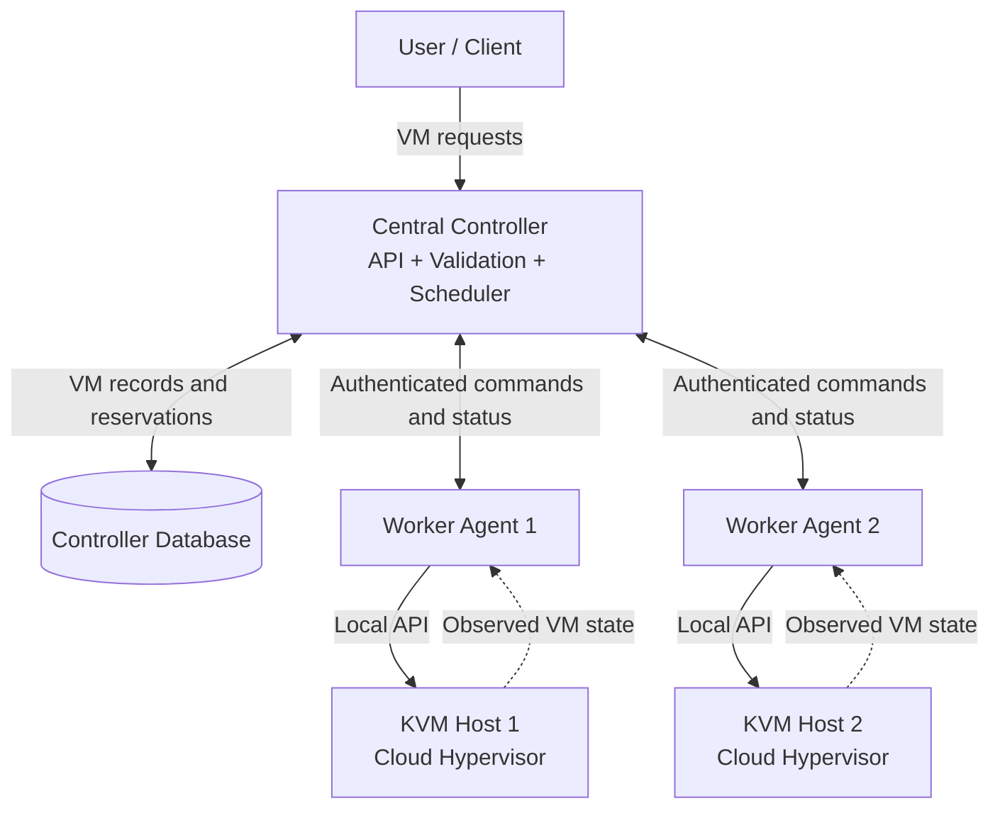
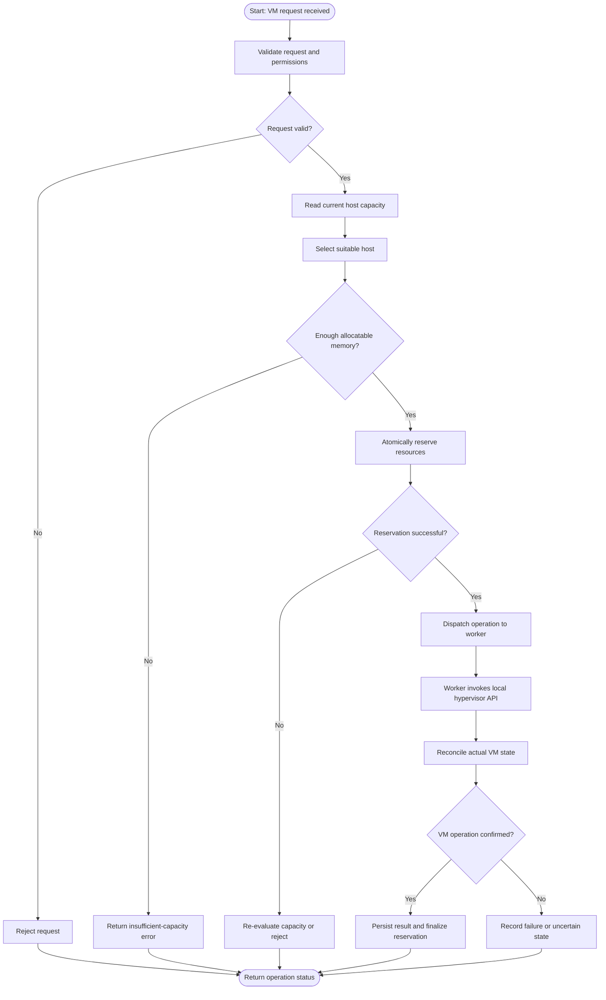
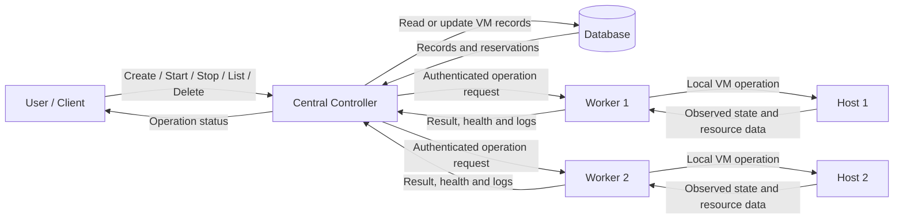
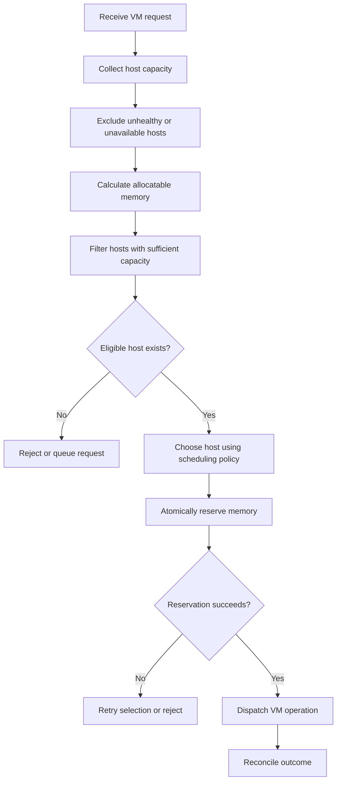
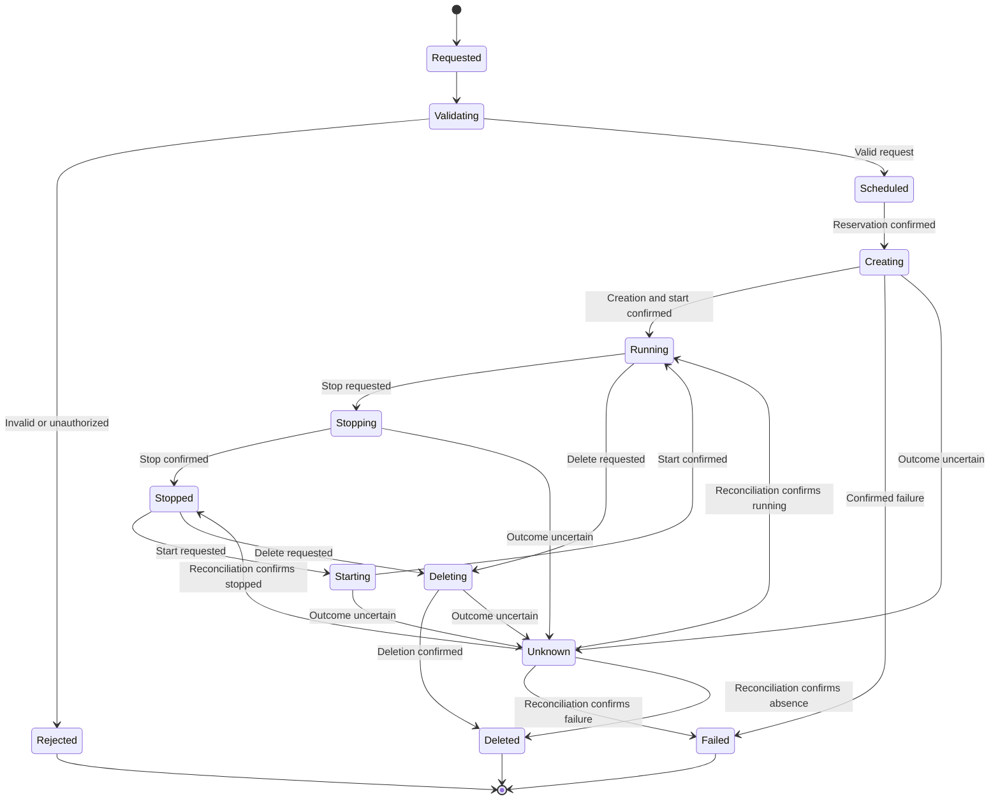
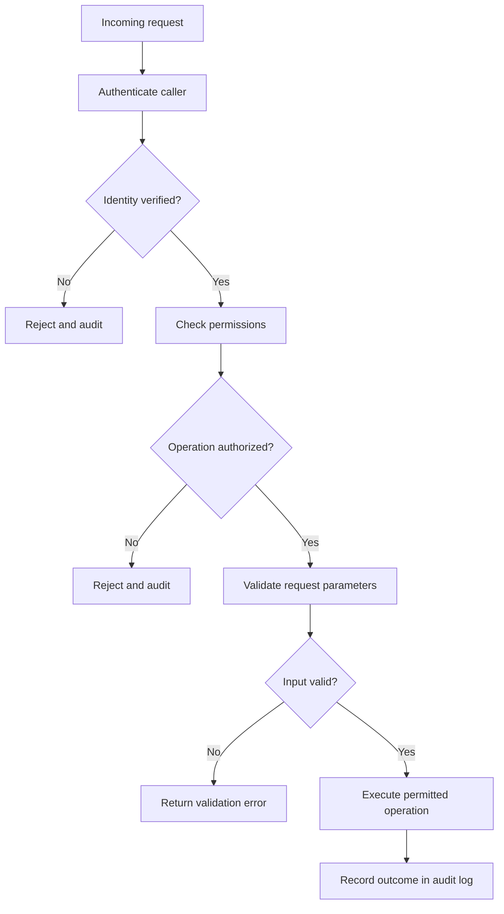
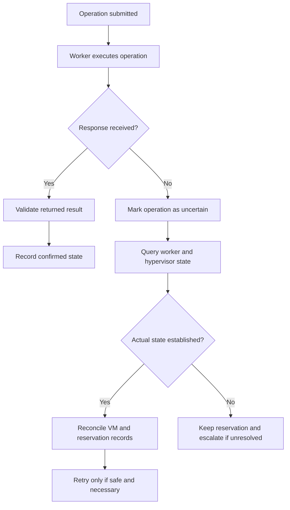
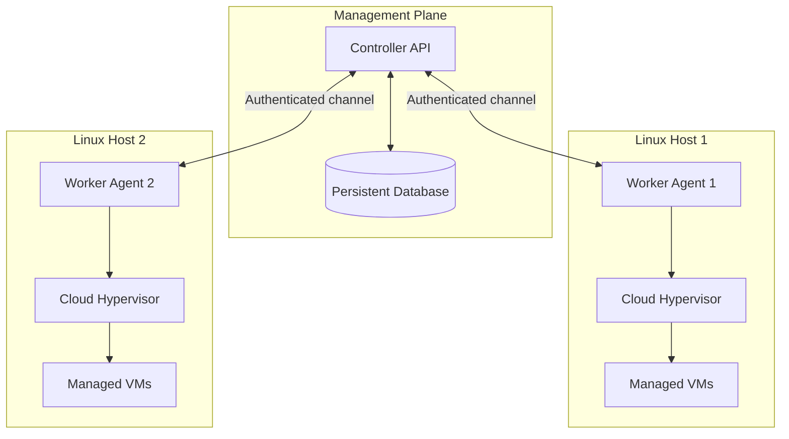

# PS-023: Minimal Two-Node Cloud Hypervisor VM Controller

**🎥 Demo Video:** [Watch the PS-023 Live Project Demonstration](https://youtu.be/iMdf5uf8Ftw)

**📽️ Project Explanation:** [Watch the PS-023 Project Explanation](https://youtu.be/2IhxcSRknVc)

**Team:** The Mavericks  
**Team Code:** `A3-PS023-TC246`  
**Project:** A minimal centralized virtual machine controller for two KVM-capable Linux hosts.

---

## Table of Contents

- [Demo Video](#demo-video)
- [Project Video](#project-video)
- [1. Project Overview](#1-project-overview)
- [2. Problem Statement](#2-problem-statement)
- [3. Objectives](#3-objectives)
- [4. Key Features](#4-key-features)
- [5. System Architecture](#5-system-architecture)
- [6. Technology Stack](#6-technology-stack)
- [7. System Workflow](#7-system-workflow)
- [8. Data Flow Diagram](#8-data-flow-diagram)
- [9. Memory-Aware Scheduling](#9-memory-aware-scheduling)
- [10. Virtual Machine Lifecycle](#10-virtual-machine-lifecycle)
- [11. Security Architecture](#11-security-architecture)
- [12. Failure Handling and Recovery](#12-failure-handling-and-recovery)
- [13. Database and State Management](#13-database-and-state-management)
- [14. API Design](#14-api-design)
- [15. Deployment Architecture](#15-deployment-architecture)
- [16. Installation and Setup](#16-installation-and-setup)
- [17. Testing and Validation](#17-testing-and-validation)
- [18. Performance Evaluation](#18-performance-evaluation)
- [19. Project Roadmap](#19-project-roadmap)
- [20. Limitations and Non-Goals](#20-limitations-and-non-goals)
- [21. Troubleshooting](#21-troubleshooting)
- [22. Contributing](#22-contributing)
- [23. References](#23-references)

---

## Demo Video

Watch the complete project demonstration:

[https://youtu.be/iMdf5uf8Ftw](https://youtu.be/iMdf5uf8Ftw)

## Project Video

Watch the project explanation and walkthrough:

[https://youtu.be/2IhxcSRknVc](https://youtu.be/2IhxcSRknVc)

---

## 1. Project Overview

PS-023 proposes a lightweight, centralized Virtual Machine (VM) controller that manages virtual machines across two KVM-capable Linux hosts using Cloud Hypervisor.

Instead of managing virtual machines independently on each host, the system introduces a central controller that accepts requests, selects a suitable host, coordinates VM operations, and tracks the resulting state. A worker agent on each host performs the actual VM operations through the local Cloud Hypervisor API.

The system focuses on safe resource allocation, memory-aware scheduling, authenticated controller-worker communication, health monitoring, state reconciliation, and reliable cleanup.

### The core idea

A user submits a VM request. The controller validates the request, reserves the required resources, chooses a suitable host, and dispatches the operation to its worker. The worker executes the operation and returns its status. The controller reconciles the result with the observed VM state and updates its records.

### Project goals

- Simplify VM lifecycle management across two physical or virtualized compute hosts.
- Prevent memory overcommitment caused by concurrent scheduling requests.
- Separate centralized orchestration from host-level execution.
- Reduce inconsistent VM records and duplicate operations after failures.
- Establish a modular foundation for future multi-host virtualization management.

---

## 2. Problem Statement

Managing virtual machines across multiple compute hosts requires reliable coordination, efficient resource allocation, and secure communication. Without centralized management, operations such as creating, starting, stopping, listing, and deleting VMs can become difficult to coordinate when multiple requests compete for limited resources.

The proposed solution is a centralized controller supported by two worker agents. The controller performs host selection and resource reservation, while workers execute VM operations locally. Health monitoring, state reconciliation, and safe resource cleanup help maintain consistency when requests time out or workers become unavailable.

---

## 3. Objectives

1. **Centralized orchestration:** Provide one management interface for VM lifecycle operations across both hosts.
2. **Safe scheduling:** Select a host using available memory and maintain consistent resource reservations.
3. **Secure communication:** Authenticate controller-worker requests and restrict access to privileged VM operations.
4. **Reliable execution:** Handle timeouts, worker failures, and uncertain VM states through reconciliation.
5. **Resource consistency:** Keep VM records and reservations aligned with observed host state.
6. **Testable implementation:** Validate concurrency, failure scenarios, access control, and resource cleanup.

---

## 4. Key Features

| Feature | Purpose |
|---|---|
| Centralized controller | Coordinates requests and host selection |
| Two worker agents | Execute VM operations on individual hosts |
| Cloud Hypervisor integration | Provides host-local VM lifecycle control |
| Memory-aware scheduling | Chooses a host with sufficient allocatable memory |
| Atomic reservations | Prevents concurrent requests from claiming the same capacity |
| VM state tracking | Maintains the controller's view of each VM |
| Authenticated communication | Restricts controller-worker interactions |
| Health monitoring | Detects worker unavailability |
| State reconciliation | Resolves discrepancies between recorded and actual VM states |
| Resource cleanup | Releases reservations when their associated resource usage ends |
| Structured logging | Supports debugging, auditing, and incident investigation |

The table describes the intended feature set. Each item should be marked implemented, tested, or planned based on the actual repository.

---

## 5. System Architecture

The architecture separates request handling, orchestration, state management, and host-level execution.



### 5.1 Central controller

The controller is responsible for:

- Receiving and validating client requests.
- Authenticating and authorizing users.
- Selecting an appropriate worker and host.
- Coordinating resource reservations.
- Tracking VM lifecycle operations.
- Reconciling operation results and observed state.
- Exposing operational status and health information.

A Python API framework such as FastAPI, with Pydantic for request validation, is a proposed implementation choice.

### 5.2 Worker agents

Each host runs a worker agent responsible for:

- Receiving authenticated instructions from the controller.
- Validating the requested operation and VM parameters.
- Communicating with the local Cloud Hypervisor API.
- Collecting VM and host resource information.
- Returning structured operation results.
- Reporting health and helping reconcile actual VM state.

Workers should not expose unrestricted host administration or arbitrary shell execution through the controller API.

### 5.3 Cloud Hypervisor

Cloud Hypervisor performs the VM-level operations on each host. The worker should use its documented local API, commonly accessed through a UNIX domain socket, instead of allowing remote clients direct access to the hypervisor interface.

### 5.4 Controller database

The database stores controller-owned information such as VM identifiers, assigned hosts, desired state, observed state, operation status, and resource reservations.

SQLite is a reasonable choice for a minimal prototype. Its transaction and concurrency behavior must be handled correctly by the implementation.

---

## 6. Technology Stack

| Component | Proposed technology | Responsibility |
|---|---|---|
| Controller API | Python + FastAPI | Request handling and orchestration |
| Request validation | Pydantic | Validate VM configuration and API inputs |
| Worker agent | Python asynchronous service | Host-level VM execution |
| Hypervisor | Cloud Hypervisor | VM lifecycle operations |
| Virtualization | Linux KVM | Hardware-assisted virtualization |
| State persistence | SQLite | VM records and reservations |
| Process and task coordination | Python asyncio / process supervision | Concurrent operations and task management |
| Resource isolation | Linux cgroup v2, where applicable | Resource control and process isolation |
| API semantics | HTTP | Structured request and response exchange |
| Testing | pytest and integration-test tooling | Functional, concurrency, and failure testing |

These are proposed choices, not confirmation that every component is already integrated.

---

## 7. System Workflow

The following diagram shows the expected end-to-end operation of a VM creation request.



### Workflow explanation

1. The controller validates the requested VM configuration and verifies that the caller is authorized.
2. It obtains current host capacity and identifies eligible hosts.
3. It reserves the required resources atomically so concurrent requests cannot over-allocate the same capacity.
4. It sends the operation to the selected worker, which invokes the local hypervisor API.
5. The controller checks the result against the observed VM state.
6. It records the confirmed outcome or marks the operation as failed or uncertain for further reconciliation.

**Important:** A timeout does not prove that VM creation failed. The VM may have been created even if the response was lost. The controller must reconcile the actual state before retrying.

---

## 8. Data Flow Diagram

This diagram focuses on how information moves between the user, controller, database, workers, and hosts.



### Main data categories

- **Request data:** VM configuration, requested memory, and lifecycle action.
- **Scheduling data:** Host capacity, reserved resources, and placement decisions.
- **State data:** VM identifiers, assigned host, desired state, and observed state.
- **Operational data:** Worker health, operation results, errors, and timestamps.
- **Security data:** Authenticated identities, authorization decisions, and audit events.

The controller should avoid logging secrets or unnecessary sensitive VM configuration.

---

## 9. Memory-Aware Scheduling

The scheduler must choose a host that can safely accommodate the requested VM.

### 9.1 Host eligibility

A host is eligible only when it is reachable, operational, and has enough allocatable memory for the request.

A simplified memory calculation is:

\[
M_{\text{available}} =
M_{\text{allocatable}} -
M_{\text{reserved}}
\]

A new VM can be considered for placement when:

\[
M_{\text{requested}} \leq M_{\text{available}}
\]

Here, `allocatable` means the memory budget the scheduler is allowed to assign, after accounting for the host's operating-system needs and configured safety margin. It should not simply equal total physical RAM.

### 9.2 Scheduling flow



### 9.3 Atomic reservations

The reservation operation must be protected against concurrent requests. For example, two requests must not both read the same free capacity and independently reserve all of it.

The reservation transaction should:

1. Read the latest resource budget.
2. Verify that sufficient capacity remains.
3. Create or update the reservation.
4. Commit the reservation atomically.
5. Dispatch the operation only after the reservation is secured.

A failed or uncertain operation must not automatically release its reservation until reconciliation determines whether the VM is using the resource.

### 9.4 Scheduling policy

A simple implementation can choose the first eligible host or use a policy such as best-fit or least-utilized host selection.

The selected policy should be deterministic where practical, observable through logs, and evaluated using the same workload across candidate policies. More complex optimization should only be added if the two-host use case benefits from it.

---

## 10. Virtual Machine Lifecycle

The controller should maintain a clear lifecycle model rather than treating every API call as an immediate state change.



The diagram is a conceptual lifecycle model. The implementation may require additional states, such as `queued`, `stopping`, `deleting`, or `reconciling`.

### Lifecycle rules

- Validate VM parameters before scheduling.
- Record the intended operation before executing it.
- Do not report a VM as running solely because a start request was accepted.
- Confirm the observed hypervisor state before marking an operation complete.
- Distinguish a confirmed failure from an uncertain outcome.
- Release reservations only when resource usage is known to have ended.
- Use stable VM identifiers and operation identifiers to support reconciliation.

---

## 11. Security Architecture

Security is a core requirement because VM management involves privileged operations on host machines.

### 11.1 Threat model

The system should consider:

- Unauthorized users attempting VM operations.
- Forged or replayed controller-worker requests.
- A compromised worker or controller.
- Exposure of the hypervisor's local management socket.
- Malformed VM configuration and resource-exhaustion requests.
- Secrets leaking through logs, error messages, or configuration files.
- Duplicate operations following network failures.
- Database corruption or inconsistent resource reservations.

### 11.2 Security controls

| Area | Required control | Purpose |
|---|---|---|
| Authentication | Verify the identity of users and workers | Reject unauthorized callers |
| Authorization | Enforce role- and operation-based permissions | Limit who can create, stop, or delete VMs |
| Transport | TLS for network communication, with mutual TLS where suitable | Protect data in transit and authenticate peers |
| Hypervisor API | Keep its UNIX socket local and restrict filesystem permissions | Prevent unauthorized direct hypervisor access |
| Privileges | Run controller and workers with minimal required permissions | Limit the impact of compromise |
| Input validation | Validate memory, CPU, image paths, identifiers, and configuration fields | Reject unsafe or malformed requests |
| Secrets | Use protected secret files or a secret manager | Avoid hard-coded credentials |
| Network | Restrict worker ports to trusted controller traffic | Reduce the attack surface |
| Replay and retries | Use operation IDs and idempotency controls | Avoid duplicate side effects |
| Logging | Record actor, operation, target, outcome, and timestamp without secrets | Support auditing |
| Resource limits | Apply request limits, quotas, and host resource boundaries | Reduce denial-of-service risk |
| Updates | Keep operating systems and hypervisor packages patched | Reduce exposure to known vulnerabilities |

These controls describe the intended security baseline. They must be implemented and verified before the project is described as secure or production-ready.

### 11.3 Authentication and authorization flow



### 11.4 Network security

- Do not expose Cloud Hypervisor's management socket directly to the network.
- Restrict controller and worker network ports using host firewalls.
- Prefer authenticated encrypted channels for remote worker communication.
- Use distinct identities and credentials for the controller and each worker.
- Rotate credentials and revoke access when a worker is removed.
- Avoid trusting a worker merely because its IP address is known.

### 11.5 Privilege separation

The controller should not need unrestricted root access on every host. Workers should use a narrowly scoped execution model, with only the permissions required to perform approved VM operations.

Where elevated privileges are unavoidable, isolate the privileged operations and prevent user-controlled strings from becoming arbitrary shell commands.

### 11.6 Secure input handling

The controller and workers should validate:

- CPU and memory values against configured bounds.
- VM identifiers against a defined format.
- Image and resource paths against approved locations.
- Supported lifecycle actions against an allowlist.
- Request body sizes and field types.
- Any hypervisor-specific configuration against a strict schema.

Avoid shell command construction from untrusted input. Prefer direct API calls and validated argument structures.

### 11.7 Audit logging

A useful audit event should contain:

- Timestamp.
- Authenticated actor or service identity.
- Operation identifier.
- VM identifier, where applicable.
- Target host.
- Requested operation.
- Authorization decision.
- Final outcome or uncertainty status.

Do not log passwords, private keys, authentication tokens, or sensitive guest data. Protect audit logs against unauthorized modification and limit access to them.

---

## 12. Failure Handling and Recovery

Distributed VM operations can fail in ways that are not immediately observable. A timeout may mean the request never reached the worker, the operation failed, or the operation succeeded but its response was lost.

### Recovery workflow



### Failure scenarios

| Scenario | Expected behavior |
|---|---|
| Worker is unreachable | Mark it unhealthy, stop new placements there, and investigate existing operations |
| VM creation times out | Check actual VM state before deciding whether to retry |
| Controller restarts | Reload persisted records and reconcile in-progress operations |
| Hypervisor API returns an error | Record the failure and inspect whether any side effects occurred |
| Database operation fails | Avoid dispatching work without the required durable reservation |
| Resource reservation conflicts | Re-evaluate capacity instead of over-allocating |
| VM is deleted outside the controller | Reconcile the controller's records with host state |
| Cleanup fails | Keep a visible cleanup-pending state and retry safely |
| Host becomes unavailable | Preserve uncertainty about its VMs until their state can be established |

### Recovery principles

1. **Reconciliation before retry:** Verify actual VM state before repeating a potentially non-idempotent operation.
2. **Durable operation tracking:** Persist enough information to resume or investigate interrupted work.
3. **Safe cleanup:** Do not release reservations merely because an operation returned a timeout.
4. **Bounded retries:** Use limits and backoff to avoid overwhelming an unhealthy host.
5. **Observable uncertainty:** Represent unknown states explicitly rather than incorrectly reporting success or failure.

---

## 13. Database and State Management

The database should distinguish between what the controller wants to happen and what the host has confirmed.

### Suggested entities

| Entity | Example fields | Purpose |
|---|---|---|
| Hosts | `host_id`, `health_status`, `last_seen` | Track registered hosts and health |
| Virtual machines | `vm_id`, `host_id`, `desired_state`, `observed_state` | Track VM identity and state |
| Reservations | `reservation_id`, `vm_id`, `host_id`, `memory_mb`, `status` | Track resource commitments |
| Operations | `operation_id`, `vm_id`, `action`, `status`, `created_at` | Track lifecycle operations |
| Audit events | `event_id`, `actor`, `action`, `timestamp`, `outcome` | Support investigation and accountability |

These are suggested logical entities; actual table names and fields should follow the implemented schema.

### State consistency rules

- VM identifiers must remain stable across retries.
- Resource reservations must be associated with a specific VM or operation.
- Capacity checks and reservation creation must be atomic.
- A VM's desired state must not be confused with its observed state.
- Interrupted operations must remain discoverable after controller restart.
- Reservation cleanup must be idempotent and safe to repeat.
- Database records must be reconciled with the actual hypervisor state periodically or after relevant failures.

### Example operation statuses

`PENDING`, `IN_PROGRESS`, `SUCCEEDED`, `FAILED`, `UNKNOWN`, `RECONCILIATION_REQUIRED`.

Use a consistent state model across the controller, worker protocol, and database.

---

## 14. API Design

The following endpoints are a proposed API shape, not a claim about the current implementation.

| Method | Example endpoint | Purpose |
|---|---|---|
| POST | `/vms` | Request VM creation |
| GET | `/vms` | List managed VMs |
| GET | `/vms/{vm_id}` | Retrieve VM details |
| POST | `/vms/{vm_id}/start` | Request VM startup |
| POST | `/vms/{vm_id}/stop` | Request VM shutdown |
| DELETE | `/vms/{vm_id}` | Request VM deletion |
| GET | `/hosts` | List registered hosts and reported capacity |
| GET | `/health` | Check controller health |
| GET | `/operations/{operation_id}` | Inspect operation status |

### API design principles

- Validate all inputs using explicit schemas.
- Authenticate callers and authorize each operation.
- Return structured error responses.
- Use stable identifiers for VMs and operations.
- Define whether operations are synchronous or asynchronous.
- Support idempotency for operations that can create side effects.
- Apply request timeouts and bounded request sizes.
- Avoid returning secrets or unrestricted host details.
- Document status codes and the meaning of each operation state.

### Example VM creation request

The following is an illustrative payload; field names must match the actual API.

```json
{
  "name": "demo-vm",
  "vcpus": 2,
  "memory_mb": 2048,
  "image": "approved-images/demo-image"
}
```

A successful request should return a VM or operation identifier and a clearly defined status. The response should not claim that the VM is running until that state has been confirmed.

---

## 15. Deployment Architecture

The system requires two KVM-capable Linux hosts and a controller that can communicate with both worker agents.



### Deployment requirements

Each worker host should have:

- A supported Linux installation.
- Hardware virtualization support and KVM availability.
- Cloud Hypervisor and its required dependencies.
- Sufficient CPU, memory, storage, and networking.
- Correct permissions for the hypervisor API socket.
- A worker service configured to communicate with the controller.
- Firewall rules that allow only the necessary management traffic.

The controller host should have:

- The controller runtime and dependencies.
- Persistent storage for the database.
- Network connectivity to both workers.
- Protected configuration and credentials.
- Logging, health checks, and restart supervision.

The controller and worker can be deployed on separate machines or arranged according to the project environment. Exact placement depends on the final implementation.

---

## 16. Installation and Setup

> **Important:** The repository-specific installation commands cannot be finalized without the actual source tree, dependency files, configuration schema, and service definitions. The following is a deployment checklist, not a verified copy-paste installation procedure.

### 16.1 Prepare the hosts

On both Linux hosts:

1. Verify hardware virtualization support.
2. Install and configure KVM and Cloud Hypervisor.
3. Verify the local hypervisor API is accessible to the intended worker identity.
4. Create approved locations for VM images and other required resources.
5. Configure host firewalls and management networking.
6. Confirm adequate memory and storage capacity.

### 16.2 Prepare the controller

1. Install a supported Python version.
2. Create an isolated Python environment.
3. Install dependencies from the project's dependency lock or requirements file.
4. Configure database storage.
5. Configure authentication and worker identities.
6. Start the controller through the documented service or development command.
7. Verify the controller health endpoint.

### 16.3 Prepare each worker

1. Install the worker dependencies.
2. Configure the controller address and worker identity.
3. Configure access to the local Cloud Hypervisor API.
4. Set filesystem permissions and required privileges.
5. Start the worker under an appropriate service manager.
6. Confirm that the controller can authenticate the worker and receive health information.

### 16.4 First end-to-end test

After both workers are registered:

1. Confirm both hosts appear healthy.
2. Submit a small VM request within the available resource budget.
3. Confirm that the controller reserves memory before dispatch.
4. Verify that the selected worker performs the requested operation.
5. Inspect the actual VM state on the selected host.
6. Confirm that controller records match the observed state.
7. Stop and delete the test VM.
8. Confirm that the reservation is safely released.

Never use production credentials or sensitive VM images in an initial demonstration environment.

---

## 17. Testing and Validation

Testing must cover individual components as well as the interactions between them.

### Test categories

| Test category | Example validation |
|---|---|
| Request validation | Reject missing, malformed, or out-of-range VM parameters |
| Authentication | Reject requests with invalid credentials |
| Authorization | Prevent unauthorized lifecycle operations |
| VM lifecycle | Verify create, start, stop, list, and delete |
| Scheduling | Select only hosts with sufficient allocatable memory |
| Concurrency | Ensure simultaneous requests cannot over-reserve memory |
| Worker communication | Handle connection errors and invalid responses |
| Failure recovery | Reconcile VM state after worker or controller interruption |
| Resource cleanup | Release reservations only when safe |
| Persistence | Recover operation records after controller restart |
| Audit logging | Verify events are recorded without exposing secrets |
| Integration | Validate the full controller-worker-hypervisor path |

### Core acceptance criteria

- A valid VM request reaches an eligible host.
- An invalid or unauthorized request is rejected.
- The scheduler never knowingly exceeds its configured memory budget.
- Concurrent reservations remain consistent.
- Timeouts do not automatically trigger unsafe duplicate operations.
- Controller and observed VM states can be reconciled after interruption.
- Reservations are not released while their resources remain in use.
- Worker failures are observable.
- Sensitive credentials do not appear in logs or source control.

These are acceptance criteria, not completed test results. Record actual outcomes, logs, and evidence when the tests are run.

---

## 18. Performance Evaluation

The project should be evaluated using repeatable workloads rather than unsupported performance claims.

### Suggested measurements

- VM creation and startup latency.
- VM shutdown and deletion latency.
- Scheduling decision latency.
- Number of concurrent requests handled.
- Reservation conflicts and rejected requests.
- Memory allocation safety under concurrent workloads.
- Worker failure detection and reconciliation time.
- Cleanup completion time.
- Controller CPU and memory consumption.

### Suggested experiment

Run the same VM workload against both hosts, recording the initial capacity, request parameters, scheduling decision, operation timestamps, final VM state, and cleanup result.

Repeat tests with different VM memory requests and concurrent request counts. Include failed and timed-out operations to evaluate correctness, not just speed.

Do not report numerical improvements until they have been measured under a documented test setup.

---

## 19. Project Roadmap

| Milestone | Deliverables |
|---|---|
| M1 — Environment Setup | Two hosts prepared, KVM and Cloud Hypervisor verified |
| M2 — Worker Development | Local VM lifecycle operations and worker health reporting |
| M3 — Controller and Scheduling | Controller API, persistent records, memory-aware scheduling, atomic reservations |
| M4 — Security | Authenticated communication, authorization, input validation, and protected hypervisor access |
| M5 — Monitoring and Recovery | State reconciliation, timeout handling, worker health checks, safe cleanup |
| M6 — Testing | Functional, concurrency, integration, and failure tests |
| M7 — Final Demonstration | Reproducible deployment, test evidence, diagrams, and project documentation |

Milestones may overlap depending on the team and implementation progress. Mark each milestone complete only when its acceptance criteria have been verified.

---

## 20. Limitations and Non-Goals

The project deliberately focuses on a minimal two-host VM controller rather than a full cloud platform.

Unless separately implemented, the following are outside the core scope:

- Live VM migration between hosts.
- Distributed storage or automatic shared-disk management.
- A browser-based graphical console or VNC gateway.
- A VM image marketplace.
- A custom hypervisor implementation.
- Large-scale multi-region orchestration.
- Automatic high availability of the controller itself.

A two-host controller also has operational limitations. If the controller or database becomes unavailable, new orchestration requests may stop even if already-running VMs continue to operate. Recovery and high availability beyond the proposed scope require additional design.

---

## 21. Troubleshooting

| Symptom | Checks |
|---|---|
| Worker is not reachable | Verify service status, network connectivity, firewall rules, and controller address |
| Authentication fails | Check worker identity, credential configuration, certificate validity, and system time |
| VM creation fails | Inspect worker logs, hypervisor API errors, image paths, and available host resources |
| Host is rejected by scheduler | Check health status, allocatable memory, active reservations, and safety margins |
| Operation remains unknown | Inspect operation logs and reconcile the actual hypervisor state |
| VM exists but database says failed | Reconcile observed state before retrying or changing reservations |
| Reservation remains allocated | Check whether the VM or operation is still active before cleanup |
| Hypervisor socket is inaccessible | Verify socket path, service status, ownership, permissions, and worker privileges |
| Controller fails after restart | Inspect database availability and the reconciliation of in-progress operations |

Logs should help diagnose problems without revealing credentials or sensitive VM data.

---

## 22. Contributing

Contributions should preserve the project's core safety invariants.

1. Create a focused branch for the proposed change.
2. Document changes to APIs, configuration, state transitions, and resource handling.
3. Add tests for normal behavior and relevant failure scenarios.
4. Verify that concurrent scheduling cannot over-reserve memory.
5. Verify that retries and cleanup remain safe after uncertain outcomes.
6. Do not commit credentials, private keys, tokens, or sensitive VM images.
7. Submit changes with a concise description of their purpose and validation results.

### Suggested development checks

Run the test and lint commands documented by the repository. Do not add commands here until the project's actual tooling and configuration have been confirmed.

---

## 23. References

1. R. N. Calheiros et al., “CloudSim: A Toolkit for Modeling and Simulation of Cloud Computing Environments and Evaluation of Resource Provisioning Algorithms,” *Software: Practice and Experience*, 2011. https://doi.org/10.1002/spe.995

2. A. Beloglazov, J. Abawajy, and R. Buyya, “Energy-aware Resource Allocation Heuristics for Efficient Management of Data Centers for Cloud Computing,” *Future Generation Computer Systems*, 2012. https://doi.org/10.1016/j.future.2011.04.017

3. Cloud Hypervisor, “API Documentation.” https://github.com/cloud-hypervisor/cloud-hypervisor/blob/main/docs/api.md

4. Linux Kernel Documentation, “Control Group v2.” https://docs.kernel.org/admin-guide/cgroup-v2.html

5. IETF, “RFC 9110: HTTP Semantics,” 2022. https://www.rfc-editor.org/rfc/rfc9110.html

6. Linux Kernel Documentation, “The Definitive KVM API Documentation.” https://docs.kernel.org/virt/kvm/api.html

---

## License

Add the project's chosen open-source license before publishing or redistributing the repository. The license should reflect the team's intended usage and distribution terms.

---

**PS-023 — The Mavericks**

*A lightweight, resource-aware, and security-conscious approach to centralized virtual machine management across two KVM-capable Linux hosts.*
